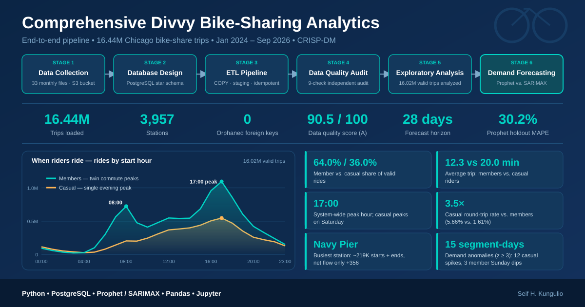

[]()

# Comprehensive Divvy Bike-Sharing Analytics

**An end-to-end data science pipeline — from raw public data to a 28-day demand forecast — built on 16.4M+ real Divvy bike-share trips using the CRISP-DM methodology.**

[](https://www.python.org/)
[](https://www.postgresql.org/)
[](https://facebook.github.io/prophet/)
[](https://jupyter.org/)

---

## Project Overview

This project builds a complete analytics pipeline for [Divvy](https://divvybikes.com/), Chicago's public bike-share system, covering every stage from raw data ingestion to a validated demand forecast. It is designed to demonstrate production-grade data engineering and data science skills — not just a one-off notebook analysis.

The pipeline collects, cleans, models, and analyzes **16.44 million individual bike trips** spanning **January 1, 2024 – September 30, 2026** (1,004 consecutive days, no gaps), stores them in a normalized PostgreSQL star schema, audits their quality independently of the ETL process, extracts business insights from the **16.02M valid trips** that remain after flagged anomalies are excluded, and forecasts future ridership using statistically validated time-series models.

**Why this project matters for recruiters:** it shows the full data science lifecycle — data acquisition, database design, ETL engineering, data quality auditing, exploratory analysis, and forecasting/model evaluation — applied to a realistic, messy, large-scale public dataset, using the same CRISP-DM framework used in industry. It also reports its own limitations honestly (see [Known Limitations](#known-limitations)): every notebook ends with a candid list of open issues, and several findings in this README are explicitly labelled as hypotheses rather than confirmed causes.

### Headline Results

| Stage | Result |
|---|---|
| Data collection | 33 monthly files (Jan 2024 – Sep 2026), ~604 MB of ZIPs → ~3.2 GB of CSVs, downloaded in ~2 minutes |
| Warehouse | 5-table star schema · 6 foreign keys · 2 `CHECK`s · 7 indexes · 2 views |
| ETL | **16,440,836 trips loaded** in ~39 minutes · 33/33 files succeeded · 0 orphaned keys |
| Data quality | **90.5 / 100 (Grade A)** with two FAILs: missing stations and a likely time-zone artifact in date fields |
| Insight | Members (64% of rides) commute; casual riders (36%) are leisure-driven, weekend-heavy and highly seasonal |
| Forecast | Prophet wins the 28-day holdout (RMSE 6,823 vs. 7,316 naive, ~7% better), but MAPE stays near 30% |

---

## Business Understanding

Divvy operates thousands of bikes across hundreds of docking stations in Chicago, serving two distinct customer segments: **annual members** (subscription riders) and **casual riders** (single-ride/day-pass users). Understanding how these segments behave — and predicting how demand will change — directly informs decisions about pricing, marketing, bike/dock inventory, and rebalancing logistics.

This project answers six core business questions:

1. How do **member and casual riders** differ in ride behavior?
2. When does **ridership peak**, and how does that differ by rider type?
3. Which **stations** are busiest, and where do bikes accumulate or run out (rebalancing risk)?
4. Are there **anomalous demand spikes or drops** worth investigating operationally?
5. How much **round-trip (recreational) vs. point-to-point (commuter) riding** occurs, and for whom?
6. What will **ridership look like over the next 28 days**, system-wide and by rider segment?

---

## Repository Structure

```
comprehensive_divvy_bike_sharing_analytics/
├── notebooks/
│   ├── 01_data_collection.ipynb          # Automated download & consolidation of raw Divvy data
│   ├── 02_database_design.ipynb          # PostgreSQL star-schema design (DDL, constraints, indexes, views)
│   ├── 03_etl_pipeline.ipynb             # Cleaning, transformation, idempotent warehouse loading, validation
│   ├── 04_data_quality_assessment.ipynb  # Independent 9-check data quality audit + weighted scorecard
│   ├── 05_exploratory_analysis.ipynb     # Business-question-driven exploratory analysis
│   └── 06_demand_forecasting.ipynb       # Time-series demand forecasting (Prophet vs. SARIMAX)
├── data/                                 # Generated locally: raw ZIPs, extracted CSVs, ingestion manifest
├── reports/
│   ├── etl_reports/                      # Per-file ETL quality report (CSV) + pipeline log
│   ├── data_quality_reports/             # Markdown / JSON / CSV audit reports + charts
│   ├── exploratory_analysis_reports/     # Result tables (CSV) + 5 figures
│   └── demand_forecasting_reports/       # Markdown / JSON / CSV forecast reports + charts
├── src/                                  # README banner
└── README.md
```

Each notebook corresponds to one stage of the CRISP-DM process. Run them in order from inside the `notebooks/` folder, because paths are resolved relative to it.

---

## The Pipeline (CRISP-DM Stages)

### 1. Data Collection — `01_data_collection.ipynb`
Automatically discovers and downloads Divvy's publicly hosted monthly trip-data ZIP files by parsing the XML index of the public `divvy-tripdata` S3 bucket — no credentials required. The pipeline is **config-driven** (start year/month) and **idempotent**: downloads are streamed in 1 MB chunks (memory-safe), and already-downloaded and already-extracted files are skipped, making re-runs safe and fast. Out of 97 objects in the bucket, 33 monthly files (Jan 2024 – Sep 2026) were selected, downloaded, extracted into per-month folders, and consolidated into a flat `csv_master/` directory (macOS `._` resource-fork files are filtered out). No October 2026 file existed at collection time, so the dataset ends on September 30, 2026.

**Results:** ~604 MB of ZIPs downloaded in about 1 min 55 s on the first run, expanding to ~3.2 GB of CSVs.

**Tech:** `requests`, `BeautifulSoup`, `tqdm`, `zipfile`, `shutil`

### 2. Database Design — `02_database_design.ipynb`
Designs a **PostgreSQL star schema** (`divvy_db.divvy`) purpose-built for analytical querying: four dimension tables (`dim_date`, `dim_station`, `dim_ride_type`, `dim_member_type`) and one fact table (`fact_trip`) with six foreign keys, a `UNIQUE` `ride_id`, and database-level `CHECK` constraints (`duration_minutes > 0`, `started_at < ended_at`). The fact table stores engineered fields (`duration_minutes`, `start_hour`, `day_of_week`, `month_partition`) derived from **Chicago local time** (the source files' clock), and two quality flags (`is_round_trip`, `is_anomalous`) so suspect rows can be flagged rather than deleted. Seven indexes target the foreign keys and month filter, and two analytical views — `vw_daily_rides` (rides and average duration by day × member type) and `vw_station_flow` (daily rides started vs. ended per station; `net_outflow = started − ended`, a direct rebalancing signal) — make the warehouse BI-ready. DDL runs in a single transaction and is idempotent; the database-creation step never drops existing data; credentials are kept out of source control via an external config file.

**Tech:** PostgreSQL, `psycopg2`, transactional DDL, PL/pgSQL

### 3. ETL Pipeline — `03_etl_pipeline.ipynb`
Cleans and loads all 33 monthly CSVs into the warehouse with defensive, production-style logic. Each file is loaded with explicit string dtypes and schema validation, then cleaned (whitespace trimming, missing/duplicate `ride_id` removal, timestamp parsing, duration computed and rounded *before* the positivity filter so rounding can't violate the DB constraint). Anomalies are **flagged rather than silently dropped** via `is_anomalous`: trips under 60 seconds, trips over 24 hours, and coordinates outside a Chicagoland bounding box. Station dimension rows are resolved with the **mode** of the station name and the **median** of its coordinates; fact rows are bulk-loaded with PostgreSQL `COPY` through a temporary staging table and merged with `ON CONFLICT (ride_id) DO NOTHING`. Each file loads in its own transaction, so one bad file can't corrupt the run, and every file contributes a row to a structured data-quality report and log.

After loading, a **verify-then-delete cleanup** step removes the intermediate `downloads/` and `csv_master/` folders (~3.7 GB freed) only if every file loaded, there are zero orphaned keys, and every month is confirmed present in `fact_trip`. It supports a `DRY_RUN` mode, refuses to delete anything outside `data/`, and records ingested months in `data/ingested_files.txt`.

**Results:**

| Metric | Value |
|---|---|
| Files processed | 33 / 33 (0 failures) |
| Raw rows in | 16,442,146 |
| Rows after cleaning | 16,441,082 (1,064 dropped — all non-positive duration after rounding, ~0.006%; no missing/duplicate IDs or unparseable timestamps) |
| Rows loaded into `fact_trip` | 16,440,836 (246 further rows skipped by `ON CONFLICT` because their `ride_id` was already loaded — 211 in the June 2024 file and 35 in the May 2026 file) |
| Rows flagged `is_anomalous` | 423,328 (~2.6%): 405,796 trips < 60 s · 17,444 trips > 24 h · 88 out-of-bounds coordinates |
| Runtime | ~39 minutes (~7,000 rows/second) |

**Post-load validation** (re-queried from the warehouse): 1,004 calendar days · 3,957 stations · 3 ride types · 2 member types · 16,440,836 fact rows · **0 orphaned foreign keys** · data spans Jan 1, 2024 – Sep 30, 2026.

**Tech:** `pandas`, `NumPy`, `psycopg2` (`execute_values`, `COPY`), `logging`

### 4. Data Quality Assessment — `04_data_quality_assessment.ipynb`
An **independent audit** that re-derives quality metrics directly from the warehouse rather than trusting the ETL's self-reported counts — a best practice for catching silent pipeline bugs. It runs 9 checks over the **full 16.44M-row fact table**: duplicate IDs, missing stations, invalid timestamps, negative durations (including a recomputed-vs-stored duration cross-check), impossible coordinates, null rates, cardinality, completeness, and consistency. For checks 1–5 and 9, each receives a PASS/WARN/FAIL verdict from explicit thresholds (≥ 1% of rows affected = FAIL, ≥ 0.1% = WARN).

**Key results:**

| Check | Result |
|---|---|
| Duplicate `ride_id`s | 0 — PASS |
| Invalid timestamps | 0 — PASS |
| Non-positive durations | 0 — PASS |
| Duration mismatches (stored vs. recomputed, > 0.5 min) | 314 (~0.002%) — PASS |
| Impossible coordinates (incl. (0, 0)) | 0 — PASS (17,107 null end coordinates reported separately) |
| Orphaned foreign keys (stations, dates, ride/member types) | 0 |
| Missing calendar days / zero-ride days | 0 of 1,004 |
| NULL station keys | 20.07% start · 20.91% end · 31.57% of trips missing at least one — FAIL (missing in the source exports, not FK errors) |
| Overall completeness (6 critical columns) | 93.17% |
| Derived-field consistency | `day_of_week` and `start_date_key` disagree with `started_at` in ~19.1% of rows (3.13M); `month_partition` in ~0.6% (100K) — FAIL (see [Known Limitations](#known-limitations)) |

A composite **0–100 Data Quality Score** is computed across five weighted dimensions and rendered with a letter grade: **90.5 / 100 (Grade A)**. The audit itself cautions that the A is borderline and coexists with two FAIL verdicts, so it should be read alongside the per-check results.

| Dimension | Weight | Score |
|---|---|---|
| Uniqueness | 20% | 100.00 |
| Completeness | 20% | 93.17 |
| Validity | 25% | 100.00 |
| Consistency | 20% | 61.27 |
| Accuracy | 15% | 97.43 |

Findings are exported as Markdown, JSON, and CSV reports plus missing-value charts (table × column heatmap and row-level presence matrix).

### 5. Exploratory Analysis — `05_exploratory_analysis.ipynb`
Directly answers the project's business questions with SQL aggregations in PostgreSQL and Python visualizations. The analysis population is **16,017,558 valid trips**: positive duration and not flagged `is_anomalous` (423,278 flagged trips, or 2.57% of the 16,440,836 loaded, are excluded). 31.57% of loaded trips lack a start or end station, so they stay in system-wide measures, but station-level metrics only include records with the relevant station key. Weekday, hour and weekend fields come from the ETL's Chicago-local keys, so they are unaffected by the UTC mismatch found in notebook 04. Outputs: five charts, four exported tables, and an auto-generated executive summary. See [Key Business Questions & Findings](#key-business-questions--findings) below.

### 6. Demand Forecasting — `06_demand_forecasting.ipynb`
Builds a gap-filled daily ridership series (1,004 days; mean ~15,950 rides/day, range 429 – 39,342) from the same valid-trip population and tests it before modeling: an Augmented Dickey-Fuller test fails to reject non-stationarity (statistic −1.993, p = 0.29), justifying differencing. Seasonal decomposition shows the "trend" is really a strong **annual cycle** (roughly 3,000–5,000 rides/day in winter vs. 25,000–30,000 in summer, with summer 2026 above 2025), while the weekly component is small (about ±1,500 rides). Four candidate models are benchmarked on a 28-day holdout (train: Jan 1, 2024 – Sep 2, 2026, 976 days; test: Sep 3 – Sep 30, 2026):

| Model | MAE | RMSE | MAPE |
|---|---|---|---|
| Naive (last value) | 5,477 | 7,316 | 33.2% |
| Seasonal naive (last week) | 5,832 | 7,509 | 31.3% |
| SARIMAX(1,1,1)(1,1,1,7) | 4,942 | 7,063 | 30.6% |
| **Prophet (selected)** | **4,906** | **6,823** | **30.2%** |

Models are ranked by RMSE, and Prophet (weekly + yearly seasonality, 80% interval) is best on all three metrics. The gains are modest: about 6.7% lower RMSE and 10% lower MAE than the naive baseline, and 3.4% lower RMSE than SARIMAX, all measured on a single 28-day window with no significance test, so the ranking is suggestive rather than conclusive. Seasonal naive actually does *worse* than naive on MAE and RMSE because it copies one unusually low training week forward four times. Error stays high (MAPE ~30% for every model) because sudden one-day demand drops (around Sept 17, Sept 19–20 and Sept 30) cannot be predicted from calendar patterns alone; they look weather- or event-driven, but the project has no weather data to confirm that.

The selected model is refit on the full history to produce a **28-day forward forecast** (Oct 1 – Oct 28, 2026) system-wide and by rider segment. Oct 1 is forecast at ~25,700 total rides (80% interval: ~21,200 – 30,200), split ~17,300 member / ~8,300 casual, falling to roughly 19,000 by the end of October as the autumn decline begins. Segment forecasts are point estimates; forecasts, like the history they're trained on, exclude flagged anomalous trips.

---

## Key Business Questions & Findings

### 1. How do member and casual riders differ?
Members dominate volume (**64.0%** of valid rides, 10.25M trips) with short, efficient trips — averaging **12.3 minutes** (median 8.8) and riding on weekends only 23.7% of the time, consistent with weekday commuting. Casual riders (36.0%, 5.77M trips) take longer trips — averaging **20.0 minutes** (median 11.9, 95th percentile 59.6 vs. 31.3 for members) — and ride on weekends far more often (37.4%), consistent with leisure use. The casual mean is about 1.7× its median (members 1.4×), signalling a long tail of very long rides, so the median is the better "typical ride" figure. Casual riders are also **3.5× more likely** to make a round trip (5.66% vs. 1.61%).

### 2. When does demand peak, and for whom?
System-wide demand peaks at **17:00**, and the busiest month in the data is **August 2026**. Members show twin commute peaks (around 08:00 and 17:00) and ride most Tuesday–Thursday (about 1.6M rides each over the period), tapering toward the weekend. Casual ridership builds through the day to a single broad afternoon peak with no morning spike and is highest on **Saturday** (about 1.2M rides vs. about 0.65M on Tuesday, roughly 1.8×), with its longest trips on weekends. Seasonality is strong for both segments, but casual demand swings far more — roughly 25K rides a month in winter vs. 300K+ in summer, while members hold a steadier 110K–120K a month (both read from the charts) — and summer 2026 is running above 2024 and 2025. Electric bikes account for 61.3% of valid rides, classic bikes 37.9%, and scooters 0.9%; casual riders ride classic bikes about twice as long as electric ones (25.2 vs. 12.2 min), while the gap for members is much smaller (13.6 vs. 10.8). These patterns suggest differentiated marketing and rebalancing schedules by day-of-week and season, though that is an interpretation rather than a tested recommendation.

### 3. Which stations are busiest, and where does bike rebalancing matter most?
By total activity (starts + ends), **Navy Pier** is the busiest station (~219K activities), followed by **Streeter Dr & Grand Ave** (~154K), **DuSable Lake Shore Dr & Monroe St** (~120K), **Michigan Ave & Oak St** (~114K), and **DuSable Lake Shore Dr & North Blvd** (~112K). Using net outflow (rides started − rides ended) as a rebalancing signal — positive means bikes drain away and the station risks running empty, negative means bikes pile up:

- **Largest net outflow:** Field Museum (+3,351); among the busiest stations, DuSable Lake Shore Dr & Monroe St (+2,358).
- **Largest net inflow:** DuSable Lake Shore Dr & North Blvd (−4,060 under one station ID, −2,357 under another); among the busiest, Streeter Dr & Grand Ave (−1,602).
- **Navy Pier is almost perfectly balanced** (+356 on ~219K activities) despite its volume.

These figures are cumulative over ~2.75 years, and even the most imbalanced busy stations gain or lose only a few percent of their traffic, so net outflow is best read as a rebalancing signal, not a capacity problem or a station-quality score.

### 4. Are there anomalous demand spikes worth investigating?
Comparing each rider segment's daily rides to its own trailing 28-day baseline (z-score ≥ 3) flagged **15 unusual segment-days**. Twelve are **casual-rider spikes, all between February and May** — e.g., March 21, 2026 (10,441 rides vs. a ~2,300 baseline, z = 4.14), March 14, 2025 (z = 4.12), and April 13, 2024 (z = 3.92) — and three are **member-rider dips, all on Sundays** (Oct 19, 2025; Sep 22, 2024; Jun 21, 2026). Thirteen of the 15 fall on a weekend. These look like weather- or event-driven demand shocks worth cross-referencing with external calendars, but the flags reflect the baseline's design as much as genuine anomalies: a 28-day window mixes weekdays and weekends and lags the seasonal ramp, so a warm early-spring weekend looks extreme. They show unusual demand *relative to the recent past*, not its cause.

### 5. How much riding is recreational (round-trip) vs. point-to-point?
Round-trip behavior is highest among **casual riders on classic bikes** — 11.0% on weekends and 9.8% on weekdays (averaging 46–48 minutes) — confirming recreational, leisure-oriented usage. It is lowest among **members on electric bikes on weekdays** (0.87%), consistent with efficient, point-to-point commuting, and weekends exceed weekdays in every rider and bike combination. Because round trips can only be detected when both stations are recorded, and these rates are calculated over all valid rides (including the ~31.6% with a missing station), they are likely understated, especially for electric bikes.

### 6. What does near-term demand look like?
The Prophet model forecasts system-wide daily ridership 28 days ahead (Oct 1 – Oct 28, 2026): about 25,700 rides on Oct 1, declining to roughly 19,000 by month-end, with member and casual breakdowns. Casual demand is more weekend-weighted and roughly halves over October (peaking around 11,700 on Saturday Oct 3, and falling to roughly 4,500–5,000 by month-end), while member demand declines more gently (to about 14,000), making members the resilient base and casual riders the seasonal segment. This gives operations and marketing teams a statistically grounded starting point for staffing, bike allocation, and campaign timing — with caution: the holdout MAPE is ~30%, and the 80% interval (about ±4,500) is likely too narrow, so real days will be noisier than the forecast line.

---

## Known Limitations

- **Consistency score is likely understated.** The audit's `day_of_week` / `start_date_key` mismatches (~3.13M rows each, ~19.1% of rows) and `month_partition` mismatches (~100K rows) most likely come from the audit reading UTC timestamps while the ETL derived those fields from Chicago local time. Supporting evidence: the first and last trip start times (06:00:39 and 04:59:38 UTC) equal 00:00:39 and 23:59:38 Chicago time. The confirming recompute in `America/Chicago` has not been run yet, so this is a hypothesis, not a confirmed result. The consistency check also sums issue counts (6.37M "issues" = 38.7% of rows) rather than counting distinct rows; counting distinct rows would lift the overall score to roughly 94.
- **Missing stations.** About 31.6% of trips have no start and/or end station in the source data, so station-level analysis and round-trip rates cover only about two-thirds of the system. The likely cause (rides without a docking station, such as dockless or e-bike rides) is not yet confirmed.
- **Station IDs are not unified.** Several physical stations appear under both a newer `CHI#####` ID and a legacy ID (e.g., DuSable Lake Shore Dr & Monroe St, & North Blvd; Michigan Ave & Oak St), splitting activity across rows in station rankings. Combined, the two Monroe St IDs (~221.6K) would outrank Navy Pier, and the two North Blvd IDs would show a net inflow of about −6.4K.
- **246 repeated `ride_id`s** (211 in the June 2024 file, 35 in the May 2026 file) were skipped by the database; the earlier months they repeat have not been traced.
- **Modest forecast lift and a single holdout.** Models improve only modestly on a naive forecast, are evaluated on one late-summer window that does not cover the steeper autumn/winter decline, and use no external features (weather, events, holidays). SARIMAX orders are a conventional default, not tuned. Prophet's yearly seasonality is estimated from fewer than three years of history, its 80% band is roughly constant in width and probably too narrow (interval coverage was not tested), and segment forecasts have no intervals.
- **Suspicious final observation.** September 30, 2026 has only 9,725 rides against 24,000–28,000 on the preceding days. It does not appear to be a partial day, and a genuine low-demand day (e.g., bad weather) is the most plausible reading, but it is unconfirmed and is included when the production models are refit.
- **Collector and storage gaps.** Notebook 01 does not yet read the ingestion manifest, so re-running it after cleanup would re-download all 33 months; it also does not paginate the bucket listing (fine at 97 keys) or verify partial downloads. The cleanup step does not cover `data/extracted/`, which holds a second copy of the CSVs (~3 GB).

---

## Technologies Used

| Category | Tools |
|---|---|
| Languages | Python, SQL (PostgreSQL / PL/pgSQL) |
| Data Engineering | Pandas, NumPy, psycopg2, PostgreSQL (`COPY`, staging tables, `ON CONFLICT` upserts), Python `logging` |
| Data Collection | requests, BeautifulSoup, tqdm |
| Time-Series Modeling | Prophet (cmdstanpy), statsmodels (SARIMAX, ADF test, seasonal decomposition, ACF/PACF) |
| Visualization | Matplotlib, Seaborn |
| Environment | Jupyter Notebook, Python virtual environments, Git |

---

## How to Run

1. Clone the repository and create a virtual environment:
   ```bash
   python -m venv venv
   source venv/bin/activate  # Windows: venv\Scripts\activate
   pip install -r requirements.txt
   ```
   Core dependencies: `requests`, `beautifulsoup4`, `lxml`, `tqdm`, `pandas`, `numpy`, `psycopg2`, `matplotlib`, `seaborn`, `statsmodels`, `prophet` (requires CmdStan via `cmdstanpy`), `tabulate`, `jupyter`.
2. Start a local PostgreSQL server and configure database credentials in an external `config` module / `database.ini` (never commit real credentials). The notebooks expect `config.config()` (server-level connection to the default `postgres` database, used to create `divvy_db`) and `config.config_divvy()` (warehouse connection), each returning a dictionary accepted by `psycopg2.connect()`.
3. Run the notebooks in order from the `notebooks/` folder — each stage depends on artifacts/tables created by the previous one:
   ```
   01_data_collection.ipynb → 02_database_design.ipynb → 03_etl_pipeline.ipynb
   → 04_data_quality_assessment.ipynb → 05_exploratory_analysis.ipynb → 06_demand_forecasting.ipynb
   ```
   A full run takes roughly 45 minutes, almost all of it the ~39-minute ETL load of ~16.4M rows. Notebook 03 ends with a cleanup step that **deletes `data/downloads/` and `data/csv_master/`** (~3.7 GB) after a verified load — set `CLEANUP_ENABLED = False` (or `DRY_RUN = True`) to keep or preview. Because the source CSVs are deleted, re-running notebook 03 requires notebook 01 to collect the data again.
4. Generated reports and charts are written to `reports/`.

---

## Future Improvements

- Re-run the consistency audit in local (Chicago) time, count issues by distinct rows, and track the Data Quality Score over time as new months load.
- Cross-tabulate missing stations by ride type to test the dockless/e-bike explanation, and inspect the 314 duration mismatches (do they cluster on daylight-saving changes?) and 17,107 null end coordinates.
- Consolidate multiple `station_id`s per physical station (via an ID crosswalk by name/coordinates) for cleaner station rankings and rebalancing signals.
- Trace the 246 repeated `ride_id`s back to the earlier months they duplicate, and have notebook 01 read the ingestion manifest so re-runs only fetch new months.
- Deploy the Prophet forecasting model as a scheduled batch job with automated retraining and drift monitoring; replace the single holdout with rolling-origin cross-validation (including October–December) and test interval coverage.
- Incorporate external features (weather, local events, holidays) to improve forecast accuracy and explain anomaly spikes; try a log or multiplicative form, since residual variance grows with demand in summer.
- Add intervals to the segment forecasts and consider reconciling them with the system total.
- Improve anomaly detection with a baseline that accounts for weekday and seasonal patterns.
- Build a live dashboard (Power BI / Streamlit) on top of `vw_daily_rides`, `vw_station_flow` and the forecast CSV/JSON outputs for operational rebalancing decisions.
- Extend station-level analysis into station × day demand forecasting and a full rebalancing optimization/routing model.
- Add automated data quality monitoring (e.g., Great Expectations) directly into the ETL pipeline.

---

## Author

**Seif H. Kungulio**

M.S. Data Analytics,

Maryville University of Saint Louis

---

## Data Source

Trip data provided by [Divvy Bikes](https://divvybikes.com/system-data) under Chicago's Divvy Bicycle Sharing Data License Agreement. This project uses publicly available, anonymized trip records; no personally identifiable information is included.
